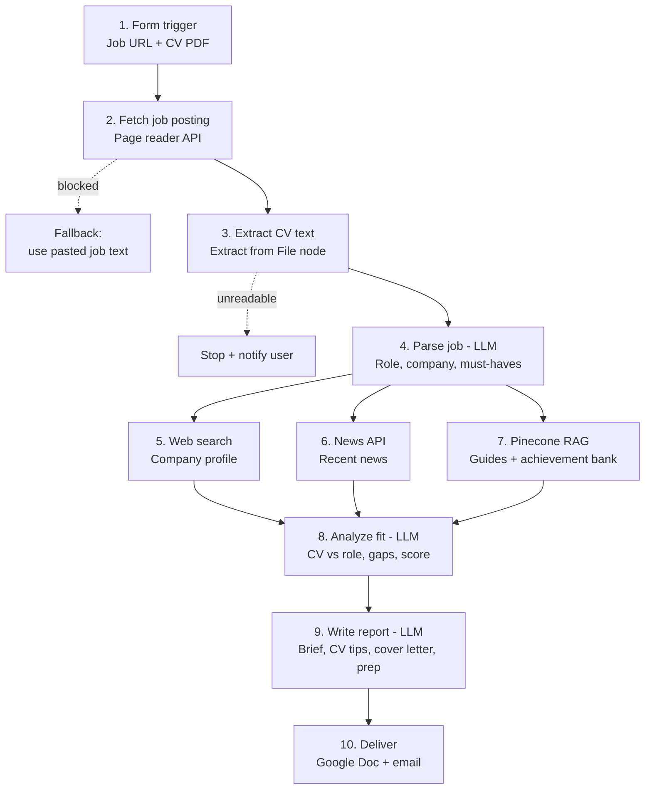

# Application Prep Agent

An autonomous n8n agent that turns a **job posting link + a candidate's CV** into a ready-to-use application pack: a company and role brief, CV improvement suggestions, a tailored cover letter and interview prep.

Built as Project 3 of the Ironhack AI Consulting & Automation Bootcamp.

---

## The problem

Career services teams at bootcamps, universities and outplacement firms prepare dozens of candidates a week for specific job applications. For each one, a coach researches the company, compares the CV against the role, suggests edits and helps with the cover letter. That is 1–2 hours of mostly repetitive work per application.

## Who it's for

- **Primary user:** career coaches and career services teams (bootcamps, universities, outplacement firms)
- **End beneficiary:** the job seeker, who gets a tailored application pack in minutes instead of hours

## What it does

1. Takes a job posting URL and a CV (PDF) through a form
2. Reads the job posting and extracts role, company and must-have requirements
3. Researches the company (profile and recent news)
4. Retrieves CV and cover-letter best practices plus the candidate's achievement bank (RAG)
5. Scores the CV against the role and identifies gaps
6. Writes a structured report and delivers it as a Google Doc and by email

### Report sections

1. **Company & role brief:** what the company does, recent news, what the role really requires
2. **Fit analysis:** match score, strengths, gaps
3. **CV suggestions:** specific bullet rewrites, not a whole new CV
4. **Tailored cover letter:** grounded only in achievements from the candidate's achievement bank
5. **Interview prep:** likely questions, stories to use, questions to ask

---

## Stack decision: n8n

The workflow is trigger-driven and mostly linear: a form submission starts the run, and it moves through fetching the posting, researching the company, matching the CV and writing the report. Its value depends on plugging into tools career services teams already use, like forms, Google Drive and email, and n8n's integrations handle those natively. The branching I need is simple and visible, such as falling back to pasted text when a job page can't be read, so a non-technical career services team could understand and maintain the workflow themselves. The reasoning steps are well-defined (research, match, critique, write) rather than open-ended exploration, so LangGraph's fine-grained control over agent loops isn't needed for this MVP. n8n also gets me to a reliable end-to-end demo within the 5-day timeline.

---

## Architecture



Steps 5–7 run in parallel and are merged before the fit analysis.

---

## Tools and APIs

| Step | Purpose | Tool |
|---|---|---|
| 2 | Read the job posting page | _TBD (e.g. Jina Reader or Firecrawl)_ |
| 5 | Company research | _TBD (e.g. Tavily or SerpAPI)_ |
| 6 | Recent company news | _TBD (e.g. NewsAPI or GNews)_ |
| 7 | Retrieval (RAG) | Pinecone |
| 4, 8, 9 | Parsing, analysis, writing | _TBD (LLM provider)_ |
| 10 | Delivery | Google Docs, Gmail |

## RAG: what's in the knowledge base

- **CV and cover-letter guidelines:** best practices the agent uses to critique the CV and structure the letter
- **Achievement bank:** a longer "master" record of the candidate's real experience and results

The cover letter may only use achievements found in the achievement bank. This keeps it from inventing experience the candidate doesn't have.

## Error handling

- **Job page can't be read** (e.g. LinkedIn blocks automated access): fall back to job description text pasted into the form
- **CV can't be parsed:** stop the workflow and notify the user
- **Search or news returns nothing:** the section is marked "limited public info" instead of being filled in by the LLM

---

## Setup

> To be completed once the workflow is built.

1. Clone the repo
2. Copy `.env.example` to `.env` and add your API keys
3. Import `workflow/application_prep_agent.json` into n8n
4. Add credentials in n8n for each tool listed above
5. Load the RAG documents into Pinecone
6. Open the form URL and submit a job link + CV

## Repository structure

```
├── README.md
├── .env.example
├── workflow/            # n8n workflow export (JSON)
├── rag_docs/            # documents loaded into Pinecone
├── sample_reports/      # at least 2 example reports
├── stack_decision.md    # (optional, also covered above)
└── gtm_future_sprints.md
```

## Sample reports

_Coming soon: at least 2 reports on different job postings in `sample_reports/`._

## Go-to-market

See [`gtm_future_sprints.md`](gtm_future_sprints.md) for the 2–3 future sprints (goal, buyer, channel, deliverable, success metric).

---

## Author

Nicolò
