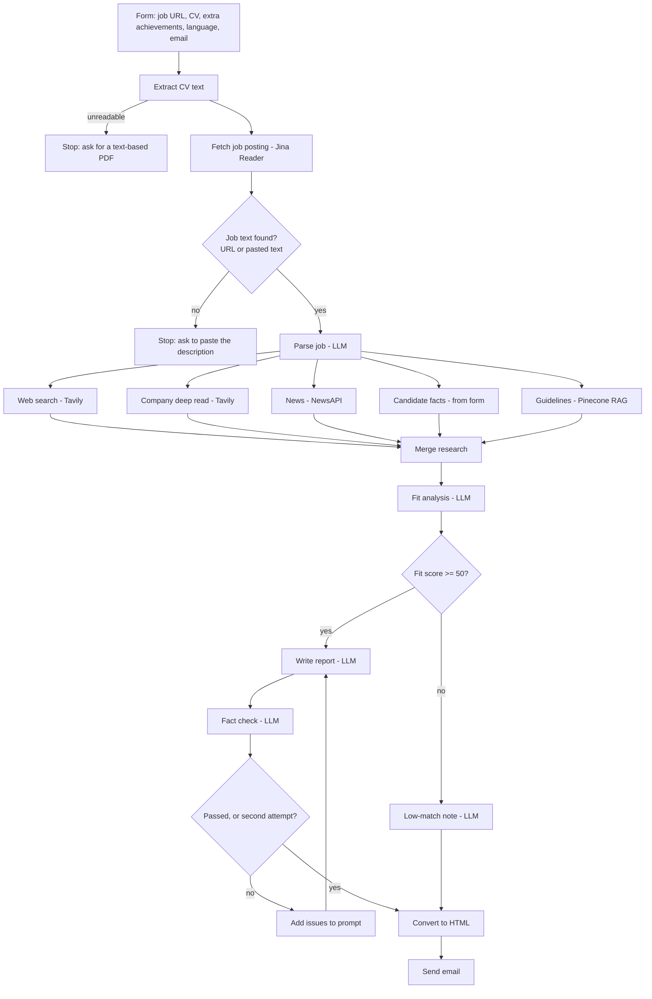

# Application Prep Agent

An autonomous n8n agent that turns a **job posting link and a CV** into a ready-to-use application pack, delivered by email: a company and role brief, an honest fit score, CV fixes, a tailored cover letter and interview prep. It fact-checks its own report before sending it.

Built as Project 3 of the Ironhack AI Consulting & Automation Bootcamp.

**Demo video:** DEMO_VIDEO_LINK &nbsp;·&nbsp; **Slides:** [`presentation/project3_slides.pdf`](presentation/project3_slides.pdf) &nbsp;·&nbsp; **Workflow:** [`workflow/application_prep_agent.json`](workflow/application_prep_agent.json) &nbsp;·&nbsp; **Landing page:** [`landing/index.html`](landing/index.html)

---

## The problem

Career services teams at bootcamps, universities and outplacement firms prepare candidates for specific applications by hand: research the company, compare the CV with the role, suggest edits, help with the cover letter, prepare for the interview. We estimate this at 1–2 hours per application (a working assumption, to be validated in the first GTM sprint). Generic AI tools speed up the writing but often invent experience the candidate doesn't have.

## Who it's for

- **Buyer:** career services and coaching teams (bootcamps, universities, outplacement firms).
- **User:** the coach, or the job seeker directly.
- **What "useful" means:** a report a coach could hand to a candidate with light edits, where every claim about the candidate is backed by their own documents.

## What the agent does

Once the form is submitted, it runs without human input:

1. Reads the CV (PDF) and the job posting (via URL, or pasted text as a fallback).
2. Extracts the role, company and requirements from the posting.
3. Researches the company in parallel: web search, the company's own about/mission pages, recent news.
4. Retrieves CV, cover letter and interview guidelines from a Pinecone knowledge base (RAG).
5. Scores the fit against every requirement.
6. **Decides:** below a score of 50 it sends a short "not a strong match" note; otherwise it writes the full pack.
7. **Fact-checks** the report against the sources. If a claim is unsupported, the report is rewritten once; anything still unverified is flagged in the email.
8. Emails the report in English or German.

### The report

| Section | Content |
|---|---|
| At a glance | Fit score, biggest strengths, main gaps, top CV fix |
| 1. Company & role brief | Business model, mission/values, dated news, what the role really needs |
| 2. Fit analysis | Score out of 100; each requirement marked strong, partial or gap, with how to address each gap |
| 3. CV suggestions | Weak bullets rewritten with real numbers, before and after |
| 4. Cover letter | 250–350 words, opening on something specific about the company |
| 5. Interview prep | Talking points, likely questions, STAR stories, questions to ask |
| Sources | Links to every source used |

---

## Stack decision: n8n

Short version (full reasoning in [`stack_decision.md`](stack_decision.md)):

The workflow is trigger-driven and mostly linear: a form submission starts the run, and it moves through fetching the posting, researching the company, matching the CV and writing the report. Its value depends on plugging into tools career services teams already use, like forms and email, and n8n handles those natively. The branching is explicit and visible (fallback when a job page can't be read, the fit-score gate, the fact-check retry), so a non-technical career services team can understand and maintain it. The reasoning steps are well-defined (research, match, critique, write, check) rather than open-ended exploration, so LangGraph's fine-grained control over agent loops isn't needed for this MVP. n8n also got the MVP to a reliable end-to-end demo within the 5-day timeline.

---

## Architecture

Two workflows that share one Pinecone index:

- **Ingestion** (`rag_loader.json`): loads the guideline documents into Pinecone. Runs only when the guidelines change.
- **Agent** (`application_prep_agent.json`): runs on every form submission and reads from Pinecone.



Screenshots of the live workflow are in [`docs/screenshots/`](docs/screenshots/).


### Tools and APIs

| Step | Purpose | Tool |
|---|---|---|
| Fetch job posting | Turn a job page into clean text | Jina Reader |
| Web search | Company profile, business model | Tavily Search API |
| Company deep read | Company's own about, mission and values pages | Tavily Search API (raw content) |
| News | Recent company news | NewsAPI |
| RAG | CV, cover letter and interview guidelines | Pinecone + OpenAI `text-embedding-3-small` |
| Parse, analyse, write, check | LLM steps | OpenAI `gpt-4o-mini` |
| Delivery | HTML email | Gmail via SMTP |

### Grounding: how the agent avoids inventing facts

- **Candidate facts** come only from the uploaded CV and the optional "Extra achievements" field. Nothing about candidates is stored in the knowledge base, so one person's facts can never appear in another person's report.
- **Company facts** come only from the search, company page and news results. If a source returns nothing, the report says "Limited public information found."
- **Guidelines** (how to write CV bullets, cover letters and interview prep) come from the RAG corpus in [`rag_docs/`](rag_docs/).
- **Fact check:** a separate LLM step checks every claim against the sources and sends the report back for one rewrite if needed. Remaining issues are shown to the reader, never hidden.

### Error handling

| Situation | What happens |
|---|---|
| CV can't be read (e.g. scanned PDF) | Stops with a clear message |
| Job page blocked or too short (e.g. LinkedIn login wall) | Uses the pasted job description; stops with a message if there is none |
| Tavily or NewsAPI fails | Retries twice, then continues without that source |
| Weak match (score below 50) | Sends a short, honest note instead of a full pack |
| Report contains unsupported claims | Rewritten once; remaining issues flagged in the email |

---

## Setup

### What to install
- **n8n** (n8n Cloud or self-hosted) with the built-in AI (LangChain) nodes. Nothing else: there is no Python code, so there is no `requirements.txt`.
- **Accounts and API keys** (free tiers are enough for testing): OpenAI, Pinecone, Tavily, NewsAPI. Jina Reader works without a key.
- **A Gmail account** with 2-Step Verification and an app password, used to send the report.

### Environment variables
The names of all keys are in [`.env.example`](.env.example). Copy it to `.env` and fill in your keys to keep track of them locally:

```
cp .env.example .env
```

| Variable | Used for |
|---|---|
| `OPENAI_API_KEY` | LLM steps and embeddings |
| `TAVILY_API_KEY` | Web search and company deep read |
| `NEWSAPI_KEY` | Company news |
| `PINECONE_API_KEY`, `PINECONE_INDEX_NAME` | RAG knowledge base |
| `JINA_API_KEY` | Optional: higher rate limit for reading job pages |
| `SMTP_USER`, `SMTP_APP_PASSWORD` | Sending the email |

n8n does not read `.env`: the same keys are entered once as **n8n credentials** (next section). `.env` is in `.gitignore` and must never be committed.

### One-time setup
1. **Create the Pinecone index:** name `application-prep`, one dense vector field named `_values`, dimension `1536`, metric `cosine`.
2. **Create the n8n credentials:**
   - OpenAI API
   - Pinecone API
   - Header Auth for Tavily: name `Authorization`, value `Bearer <your key>`
   - Header Auth for NewsAPI: name `X-Api-Key`, value `<your key>`
   - SMTP for Gmail: host `smtp.gmail.com`, port `587`, SSL/TLS off, your Gmail address and app password
3. **Load the knowledge base:** import `workflow/rag_loader.json`, attach the Pinecone and OpenAI credentials, run it once for each file in `rag_docs/`, then run the test branch to check that retrieval returns guideline text.
4. **Import the agent:** import `workflow/application_prep_agent.json`, open each node with a warning icon and select the matching credential, and set your sender address in **11b. Send Email**. The exported files contain no credentials or keys.

## How to run

1. In n8n, open **Application Prep Agent** and **activate** (or publish) it.
2. Open **1. Form Trigger** and copy the **Production URL**. Open it in a browser.
3. Fill in the form:
   - a job posting URL (or paste the description if the page is blocked, e.g. LinkedIn)
   - a CV as a text-based PDF
   - optionally, extra achievements that aren't on the CV
   - the report language and your email
4. Submit. The agent runs on its own; the report arrives by email, usually within a few minutes.
5. To follow a run, open the workflow's **Executions** tab in n8n.

**Try it with the demo candidate:** upload `sample_inputs/CV_Sofia_Lindqvist.pdf` and paste the contents of `sample_inputs/achievement_bank.md` into "Extra achievements". Sofia is fictional.

**Optional:** paste `assets/form_custom.css` into the Form Trigger's *Custom Form Styling* option, and point the buttons in `landing/index.html` to your form URL.

---

## Sample reports

Generated by the system, in [`sample_reports/`](sample_reports/):

- `01_...md`
- `02_...md`

---

## Repository structure

```
├── README.md
├── stack_decision.md         # n8n vs LangGraph
├── gtm_future_sprints.md     # 3 go-to-market sprints
├── .env.example              # which keys are needed
├── workflow/
│   ├── application_prep_agent.json   # the agent (n8n export)
│   └── rag_loader.json               # loads guidelines into Pinecone
├── rag_docs/                 # RAG corpus: CV, cover letter and interview guidelines
├── sample_inputs/            # fictional demo candidate: CV + extra achievements
├── sample_reports/           # reports generated by the system
├── landing/index.html        # product landing page
├── assets/                   # logo and form styling
├── presentation/             # slides as PDF
└── docs/
    ├── demo_script.md        # 6-minute demo plan
    └── screenshots/          # screenshots of the live workflow
```

---

## Known limitations

- **NewsAPI free plan** is for development only, delays articles by 24 hours and covers one month. A production version needs a paid news source.
- **Gmail SMTP** has daily sending limits. A production version needs a transactional email service and its own domain.
- **Job boards like LinkedIn** often block automated reading; the pasted-description fallback covers this.
- **The fact-checker is itself an LLM.** It reduces invented claims but doesn't guarantee zero errors, which is why remaining issues are shown to the reader.
- **All LLM steps use `gpt-4o-mini`** to keep costs low. A stronger model for the fit analysis, report and fact check would improve quality.
- **One rewrite only** after the fact check, to keep run time and cost predictable.

## Go-to-market

See [`gtm_future_sprints.md`](gtm_future_sprints.md) for the three sprints that take this MVP towards paying customers.

---

## Author

Nicolò Marseu
